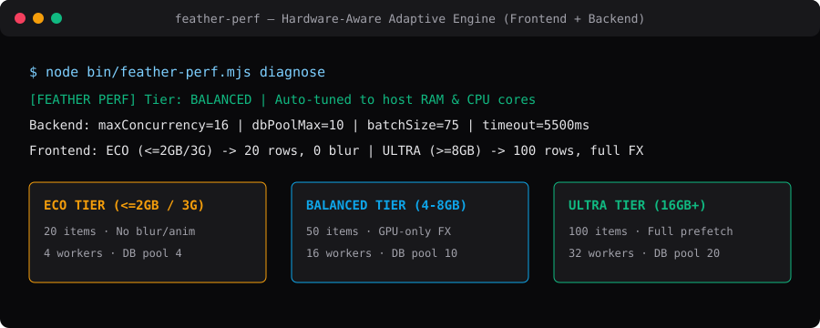

<h1 align="center">Feather Speed</h1>

<p align="center">
  <strong>Zero-dependency, hardware-aware adaptive performance engine, spec &amp; AI agent skill for lightweight frontend and backend apps.</strong><br />
  <em>Automatically tunes rendering, concurrency, DB pools, and memory budgets to each user's real RAM, CPU cores, and network speed.</em>
</p>

<p align="center">
  <a href="#-quick-start"><strong>Quick Start</strong></a> ·
  <a href="#-how-adaptive-tiers-work"><strong>Adaptive Tiers</strong></a> ·
  <a href="design-spec/ADAPTIVE_PERF_SPEC.md"><strong>Spec</strong></a> ·
  <a href="skills/adaptive-lightweight-apps/SKILL.md"><strong>AI Skill</strong></a> ·
  <a href="https://github.com/kelli-dotcom/feather-speed/issues"><strong>Issues</strong></a>
</p>

<p align="center">
  
  
  
  
  
</p>

<p align="center">
  
</p>

---

## ✨ Built for Real-World Computers (Not Just \$4,000 Dev Machines)

Most web apps are built on high-end developer laptops and freeze on a 4 GB school Chromebook, older phone, or \$5 VPS. **Feather Speed** reads the real RAM, CPU cores, and network conditions of the machine running your code—so your app runs fast, accurate, and crash-free everywhere.

- **Built For:** Solo founders, full-stack engineers, school/community software builders, and AI coding agents shipping lightweight web & mobile apps.
- **Best Used For:** Data-heavy dashboards, job boards, scrapers/sync pipelines, and public web apps serving users across mixed hardware and bandwidth.
- **Runs Everywhere:** Browser (`navigator.deviceMemory`, `hardwareConcurrency`, `connection`, `prefers-reduced-motion`) + Node.js / Bun backends (`node:os` RAM & CPU cores).
- **Proven in Production:** Auto-tunes live ATS link-audit concurrency in **[Openflex](https://github.com/kelli-dotcom/openflex)**.

---

## ⚙️ How Adaptive Tiers Work

| Tier | Trigger Conditions | Frontend Budget | Backend Budget |
| :--- | :--- | :--- | :--- |
| **`eco`** | `<= 2 GB` RAM, `<= 2` cores, `2g/3g`, or `Save-Data` | `20` items · `0` blur/anim · No prefetch | `<= 4` workers · DB pool `4` · Batch `25` |
| **`balanced`** | `4–8 GB` RAM · `4g` connection | `50` items · GPU-only motion | `<= 16` workers · DB pool `10` · Batch `75` |
| **`ultra`** | `>= 8 GB` (web) / `>= 16 GB` (server) · `8+` cores | `100` items · Full instant prefetch | `<= 32` workers · DB pool `20` · Batch `200` |

---

## 🚀 Quick Start

```bash
# Diagnose your current machine's live RAM/CPU & recommended budgets:
node bin/feather-perf.mjs diagnose
```

### Frontend (Browser / React / Next.js)
```js
import { detectFrontendProfile } from "./src/frontend.mjs";
const { tier, budgets } = detectFrontendProfile();
// budgets -> { pageSize, enableAnimations, enableBackdropBlur, prefetchLinks, imageQuality }
```

### Backend (Node.js / Bun / Workers)
```js
import { detectBackendProfile } from "./src/backend.mjs";
const { tier, budgets } = detectBackendProfile();
// budgets -> { maxConcurrency, dbPoolMax, batchSize, fetchTimeoutMs }
```

---

## 🌐 CRTA Tech Solutions Open-Source Ecosystem

| Repository | What It Does |
| :--- | :--- |
| **[openflex](https://github.com/kelli-dotcom/openflex)** | Zero-cost, anti-ghost, Remote-Truth job board (61 verified ATS feeds) |
| **[feather-speed](https://github.com/kelli-dotcom/feather-speed)** | Hardware-aware adaptive frontend & backend speed kit *(this repo)* |
| **[stack-blueprints](https://github.com/kelli-dotcom/stack-blueprints)** | 5-tier developer stack matrix & workflow file-creation order CLI + AI skill |
| **[feather-themes](https://github.com/kelli-dotcom/feather-themes)** | 1,092 photobiology-calibrated, 0-dep WCAG AA/AAA themes |
| **[agent-etiquette](https://github.com/kelli-dotcom/agent-etiquette)** | Multi-agent workflow rules, JSON handoff schemas & Rule of 2 loop caps |
| **[archetype-agent-vault](https://github.com/kelli-dotcom/archetype-agent-vault)** | 7 character-driven AI coding agent suites (27 specialists) |
| **[github-trending-kit](https://github.com/kelli-dotcom/github-trending-kit)** | AI agent & skill kit for top-GitHub READMEs, SEO topics & launch copy |

✨ *Crafted by **CRTA Tech Solutions*** • MIT License • GitHub Topic: `crta-crafted`
