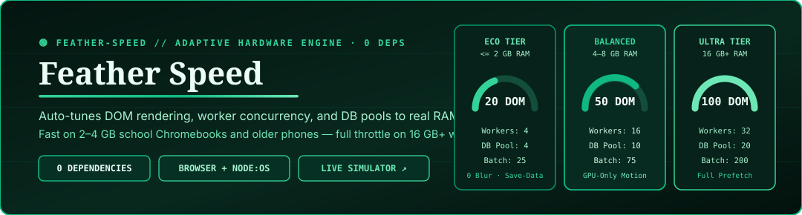

[](https://kelli-dotcom.github.io/feather-speed/preview/)

# Feather Speed

Come in. Everything here has its place, and nothing is missing.

Zero-dependency, hardware-aware adaptive performance engine, spec, and AI agent skill for lightweight frontend and backend apps.

**Inside**

- `src/` — the frontend and backend engine
- `bin/feather-perf.mjs` — diagnose and tune from the terminal
- `skills/adaptive-lightweight-apps/` — the skill
- `design-spec/` — the adaptive performance spec
- [Live Hardware Simulator](https://kelli-dotcom.github.io/feather-speed/preview/) (`preview/index.html`) — real-world 2,000-row windowing & worker queue demo, live on the web or offline

**Use it**

```sh
node bin/feather-perf.mjs diagnose
```

Details: [docs/START_HERE.md](docs/START_HERE.md). MIT license — see [LICENSE](LICENSE).
